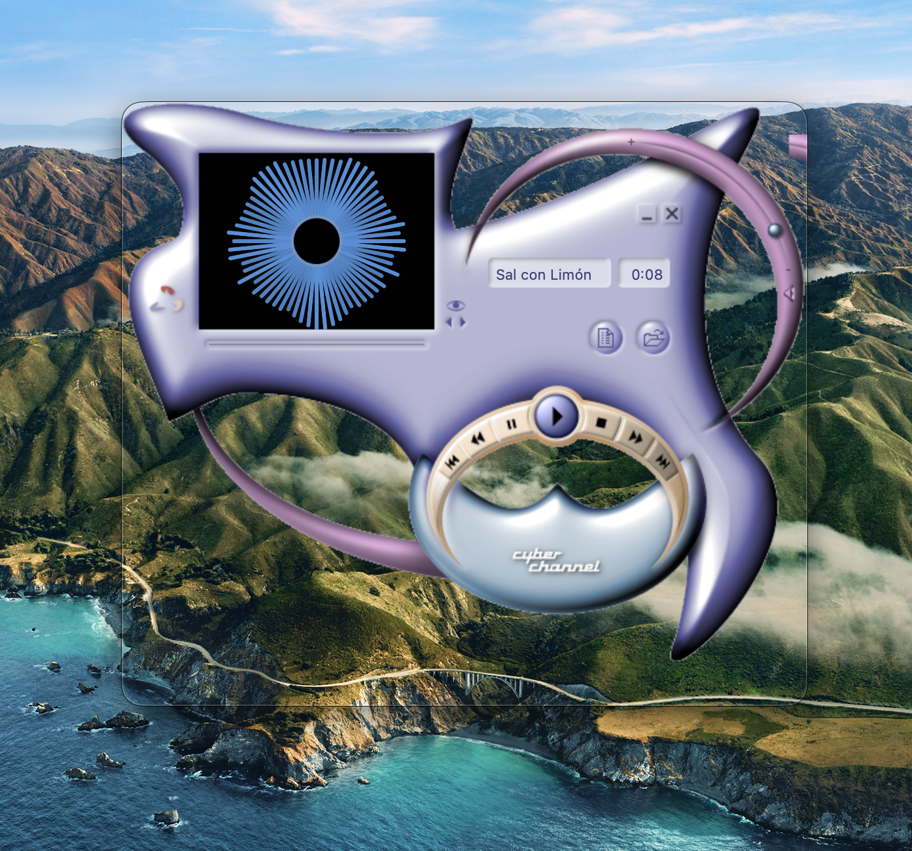

# iCarus: A Transcendental Approach to Music Streaming

A skinnable media player for macOS 13+, built with SwiftUI. Download music and video with
yt-dlp, play it with an equalizer and live visualizer, and dress the player in skins, including
Windows Media Player skins (`.wmz`).

## Run it

Open `iCarus.xcodeproj` in Xcode, choose the **iCarus** scheme with destination **My Mac**, and press ⌘R.

Get needs yt-dlp and ffmpeg: `brew install yt-dlp ffmpeg`. If downloads start failing later,
`brew upgrade yt-dlp` usually fixes it.

## What it does

**Two modes** (⌘1 Play, ⌘2 Get).

### Get
- Paste a link and download audio or video with yt-dlp. Finished files go to `~/Music/iCarus`
  (changeable) and appear in Play automatically.
- Cover art and tags are saved with each download, and the art shows in the player when a track has no video.
- **Advanced tab:** audio quality or video size, file-name styles, playlist ranges, time ranges, SponsorBlock,
  subtitles, browser cookies, speed limit, and a free-text box for other yt-dlp options (ones that run other
  programs are blocked). The exact command is shown and can be copied. "Reset to Defaults" restores the basics.

### Play
- Add songs with ⌘O or by dragging files onto the window. Queue, shuffle and repeat; playlist on ⌘L.
- Audio and video playback; the video pane appears for files that have video.
- **Equalizer** (⌘E): 10 bands, ±12 dB, presets, balance. Settings are remembered. Reset glides every band back
  to neutral instead of jumping.
- **Visualizer:** bars, waveform or radial, driven by the live audio. Click it to change style.
- Shortcuts: Space or ⌘P play/pause, ⌘→ next, ⌘← previous, ⌘. stop, ⌘, skin picker.

## Skins

A skin is a folder with a `skin.json` plus images (see `SampleSkins/`). Skins can be built-in layouts with
their own colours and fonts, or fully image-based: buttons, sliders, filmstrips, shaped transparent windows.
Choose or import one from the skin picker (⌘,). The Skin Inspector (⌘⌥I) shows a skin's element tree,
lets you toggle parts, and shows the script log.

### Windows Media Player skins
Import a `.wmz` and iCarus converts it: it reads the layout, cuts out the transparent
shape, maps buttons and sliders to the player, and keeps the whole element tree. After installing it lists
anything it couldn't map.

- **Controls:** play/pause/stop/next/previous, seek, volume and balance sliders, EQ sliders, text readouts
  (title, artist, position), visualizer and video windows, playlist pane, tooltips, skin fonts, scrolling text.
- **Live bindings:** `wmpprop:` values and `wmpenabled:` states follow the player (volume, EQ gains,
  position, button availability). No script needed.
- **Scripts:** a skin's own JavaScript runs in a sandbox that only sees a copy of the WMP object model
  (`player`, `eq`, `view`, `theme` and the skin's named elements). No file, network or program access.
  Scripts run only for skins you imported and allowed, and `launchURL` works only for http/https on a click.
  Supported: element visibility/position/value, animated `moveTo` with `onendmove`, `setTimeout`/`setInterval`,
  view timers, change and click events.
- **Not yet supported:** sounds, effect presets, fullscreen or separate video windows, and a time limit
  on scripts (a script that never returns freezes the app).

## How it's organised

```
Core/    PlayerEngine (audio, queue, EQ, visualizer), Track, DownloadManager,
         AdvancedOptions, Library, AppState
Skins/   Skin model and manager, WMP importer (WMSParser, WMPSkinBuilder, WMZImporter),
         scene model and runtime, ScriptHost (the script sandbox)
Views/   Player and Get screens, widgets, image widgets, scene canvas, inspector
```

The rule that keeps skinning simple: **functionality lives in `PlayerEngine`; presentation lives in
skins and views.** Any skin, however different it looks, drives the same engine.
